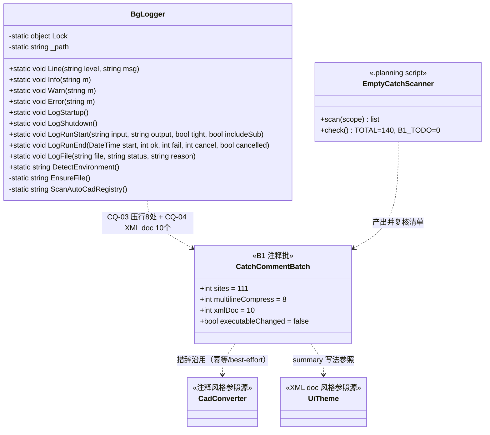
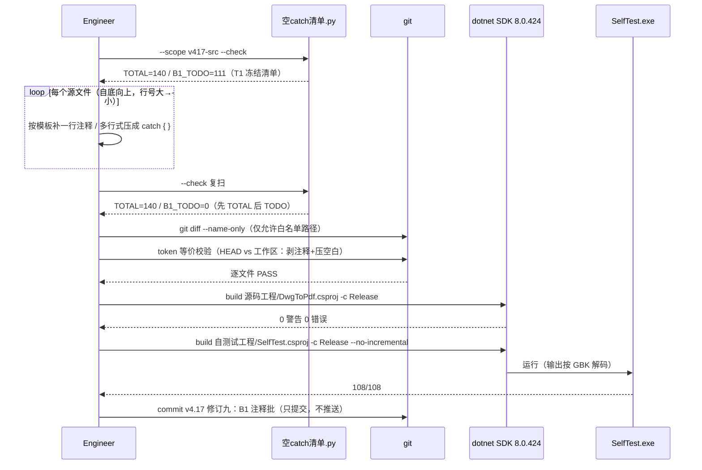
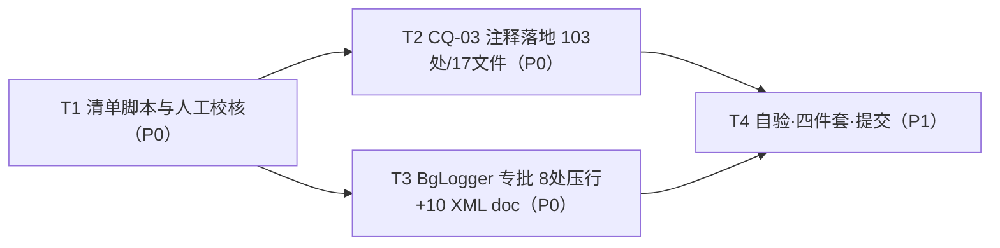

# DwgToPdf B1 注释批 增量设计文档

> 版本 v1.0 · 2026-10-16 · 架构师 Bob 制定
> 上游输入：`.planning/prd-code-quality.md`（Alice，B1 = CQ-03 + CQ-04，零风险）、《代码审查标准与流程 v1.0》（§2.1 空 catch 明断规则）
> 本阶段纪律：只读代码 + 写设计；已落盘清单脚本（只读分析，不进源码工程）`.planning/空catch清单.py`，其输出冻结于 `.planning/b1-空catch清单.txt`
> 关键实计数字（脚本复现，非抽样）：v4.17 源码工程**空 catch 总数 = 140**（与 PRD 验收基线一致）；其中「catch 行或上方 1 行无注释」= **111 处**进入 B1；另有 **13 处**归 B2（CQ-05/06）整块排除

## Part A：系统设计

### 1. Implementation Approach

#### 1.1 B1 的四个难点与对策

**难点 1：「零可执行变更」如何机器可证。**
注释/排版批的真实风险不是编译错误，而是 111 处 diff 无法逐条人读。对策是**双层校验**：

- **行级预检**：`git diff` 的每个变更 hunk 只允许三类内容——注释行（`//` 开头或行尾 `//` 注释）、空行、catch 排版行（仅含 `catch` / `{` / `}` token 的行）。
- **token 级终验（权威）**：对每个变更 .cs，取 `git show HEAD:<path>` 与工作区版本，**剥除全部注释（`//` 行/行尾、`/* */` 块）并压平所有空白**后，两侧 token 流必须完全相等。这才是 PRD「不动任何可执行代码」的机器可证形式；多行式压行（`catch`/`{`/`}` 三行 → `catch { }` 一行）前后 token 完全一致，由该校验兜底放行。

**难点 2：确定性清单。**
PRD 把清单定义为「实施时以脚本判定『catch 行或上方 1 行无注释』产出确定清单」。本设计已将该规则落成 `.planning/空catch清单.py`（规则与 PRD 逐字对齐，含两种空 catch 形态识别），实跑结果：

- 扫描范围：`DwgToPdf 工具 v4.17/源码工程` 全部 .cs（自动排除 bin/obj）。
- 空 catch 总数 **140**，分文件分布与 PRD §3 F1 逐项吻合（ConverterEngine 30、CadConverter 16、ComStarter 14、PageSetupPreprocessor 12、FrameExtractor 10、MainForm 10、BgLogger 9、ConverterEngine.Plot 9、PlotSession 7、其余文件合计 23——PRD 文中「其余 24」系笔误，总数 140 不变）。
- 注释判定：catch 行有行尾注释，或 catch 行上方紧邻 1 行是注释行（去空白后 `//` 开头）→ 判「有注释」；否则进入 B1 清单 = **111 处**。

**难点 3：跨批边界（B2 拥有 13 处）。**
B2（CQ-01/02/05/06）要改造/注释其中 13 处 catch。B1 必须整块避开，否则两批 diff 互相缠绕、违反「每批可单独 revert」。排除清单硬编码于脚本 `EXCLUDE`（T1 人工校核后冻结）：

| 文件 | 行 | 归属 |
|---|---|---|
| BgLogger.cs | 50 | CQ-06（logger 自身写盘失败 chicken-egg 注释） |
| ConverterEngine.cs | 404 / 437 / 580 / 1157 / 1188 | CQ-06（envelope catch 注释） |
| RunHistory.cs | 104 / 111 | CQ-06（改记 BgLogger.Warn） |
| MainForm.cs | 1152（多行式）/ 1930 | CQ-06（粘贴整体吞异常 / 设置保存失败静默） |
| EnvironmentSelfCheck.cs | 58 | CQ-06（修复失败吞异常） |
| FrameExtractor.cs | 426 / 563 | CQ-05（onFileDone 回调改 BgLogger.Warn） |
| LogWriter.cs | 57 / 78 / 85 | CQ-02（WriteLine/Dispose 加 LastWriteError） |

注：LogWriter.cs:64（`_onLine` 界面镜像回调 best-effort）不在 CQ-02 改造面内，保留在 B1。

**难点 4：BgLogger 双任务同文件的编辑序。**
CQ-03 的 8 处多行式压行与 CQ-04 的 10 个 XML doc 同在 BgLogger.cs（221 行），合并为 T3 一个任务顺序完成（先压行注释、后加 XML doc），避免与 T2 的 17 文件线并行改同文件。

#### 1.2 策略总览

- **无新框架、无新依赖**：net48/WinForms 工程原样；工具链为便携 dotnet SDK 8.0.424（构建）+ Python 3 标准库（只读分析脚本）。
- **编辑纪律**：按文件**自底向上**（行号从大到小），抑制行号漂移；每完成一个文件重跑脚本核对 `B1_TODO=0` 再下一个。
- **编译时机**：111 处均为小注释编辑，按 GEN-TEST-002「大批量编辑后立刻编译」在 T4 集中全量编译一次即可；如求稳可在 T2 内每约 5 个文件增量编译一次（可选，非必须）。
- **校验闭环**：T1 冻结清单 → T2/T3 落地 → 脚本复扫（TOTAL=140 且 B1_TODO=0）→ diff 面校验 → token 等价校验 → 编译 0/0 → SelfTest 108/108 → 提交。

### 2. File List

**A. 源码工程（18 个 .cs，均为注释/排版批，零可执行变更）**

| # | 相对路径（仓库根起） | B1 处数 | 内容 |
|---|---|---|---|
| 1 | `DwgToPdf 工具 v4.17/源码工程/BgLogger.cs` | 8 + 10 XML doc | 8 处多行式空 catch 压行+注释；10 个 public 方法补 XML doc |
| 2 | `DwgToPdf 工具 v4.17/源码工程/CadConverter.cs` | 12 | catch 注释（含 114/115 成对处补 1 条） |
| 3 | `DwgToPdf 工具 v4.17/源码工程/ComStarter.cs` | 14 | catch 注释 |
| 4 | `DwgToPdf 工具 v4.17/源码工程/PageSetupPreprocessor.cs` | 12 | catch 注释 |
| 5 | `DwgToPdf 工具 v4.17/源码工程/ConverterEngine.cs` | 20 | catch 注释 |
| 6 | `DwgToPdf 工具 v4.17/源码工程/ConverterEngine.Plot.cs` | 8 | catch 注释 |
| 7 | `DwgToPdf 工具 v4.17/源码工程/MainForm.cs` | 8 | catch 注释 |
| 8 | `DwgToPdf 工具 v4.17/源码工程/FrameExtractor.cs` | 6 | catch 注释 |
| 9 | `DwgToPdf 工具 v4.17/源码工程/PlotSession.cs` | 6 | catch 注释 |
| 10 | `DwgToPdf 工具 v4.17/源码工程/FrameCache.cs` | 5 | catch 注释 |
| 11 | `DwgToPdf 工具 v4.17/源码工程/RasterPlotterFactory.cs` | 4 | catch 注释 |
| 12 | `DwgToPdf 工具 v4.17/源码工程/EnvironmentSelfCheck.cs` | 2 | catch 注释（:55 p.Kill 尽力 / :90 报告写出） |
| 13 | `DwgToPdf 工具 v4.17/源码工程/Concurrency.cs` | 1 | catch 注释（env 读取尽力） |
| 14 | `DwgToPdf 工具 v4.17/源码工程/CoreConsoleLocator.cs` | 1 | catch 注释（:95 注册表扫描 envelope） |
| 15 | `DwgToPdf 工具 v4.17/源码工程/LogWriter.cs` | 1 | catch 注释（:64 界面镜像回调） |
| 16 | `DwgToPdf 工具 v4.17/源码工程/MainForm.PhaseLog.cs` | 1 | catch 注释（日志文本框刷新） |
| 17 | `DwgToPdf 工具 v4.17/源码工程/PhaseChipBar.cs` | 1 | catch 注释（tooltip 隐藏） |
| 18 | `DwgToPdf 工具 v4.17/源码工程/RunHistory.cs` | 1 | catch 注释（:92 语料对比 envelope） |

精确行号清单（预生成，T1 复核冻结）：`.planning/b1-空catch清单.txt`（111 条，含「一行式/多行式」形态与上下文预览）。行号以冻结版为准；编辑按文件自底向上执行。

**B. 计划/工具文件**

| # | 相对路径 | 用途 |
|---|---|---|
| 19 | `.planning/空catch清单.py` | CQ-03 确定性清单脚本（只读分析，Python 3 标准库） |
| 20 | `.planning/b1-空catch清单.txt` | 冻结的 111 处清单 + 140 总数证据 |
| 21 | `.planning/design-b1.md` | 本文档 |
| 22 | `.planning/sequence-diagram.mermaid` | 实施/自验时序图（提取件） |
| 23 | `.planning/class-diagram.mermaid` | B1 触及面类图（提取件） |
| 24 | `.planning/task-dependency-graph.mermaid` | 任务依赖图（提取件） |
| 25 | `.planning/progress.md` | T4 审查台账（§5 模板追加） |

**C. 文档四件套（T4 同步，硬门 §3.4）**

| # | 相对路径 |
|---|---|
| 26 | `版本变更记录.txt` |
| 27 | `DwgToPdf 工具 v4.17/说明.txt` |
| 28 | `DwgToPdf 工具 v4.17/发布程序 v4.17/运行说明.txt` |
| 29 | `DwgToPdf完整经验手册.md` |

**明确不在范围**：`DwgToPdf 工具 v4.16/` 历史树（旧版归档）；自测试工程（`--scope selftest` 可见 29 处，见 §5 Anything UNCLEAR #2）；v4.17 发布程序 exe（不重编发布物）。

### 3. Data Structures and Interfaces



要点：

- BgLogger 的 10 个 public 方法是 CQ-04 的唯一接口面（内部私有 `EnsureFile`/`ScanAutoCadRegistry` 不加 doc，PRD 未要求）。
- `EmptyCatchScanner`（脚本）是 B1 的「验收仪器」：接口只有 `scan` 与 `check`；`--check` 输出三值 `TOTAL_EMPTY_CATCH / B1_TODO / EXCLUDED_B2`。
- CadConverter / UiTheme 不是被改对象，是**风格参照源**（既有正确形态）。

### 4. Program Call Flow



### 5. Anything UNCLEAR

1. **【最重要，请主理人拍板】PRD 叙事「约 30 处」vs 脚本实计 111 处。** PRD §3 F1 / CQ-03 称 B 类约 30 处（BgLogger 8、ComStarter 8、RunHistory 1 等）。按 PRD 亲自定义的脚本规则实跑为 **111 处**；其中 BgLogger 8、RunHistory 1 与 PRD 吻合，但 ComStarter 为 14（PRD 记 8——推测审计人眼判时把「方法级 XML doc 已解释语义」的 catch，如 KillAllOwned/KillLeftoverAccore/LocateAcadExe 等，计为已覆盖）。CadConverter 另有 12 处、ConverterEngine 20 处被规则标出（多数上方 1 行是代码而非注释，但更上方有上下文注释）。**设计建议按脚本全量 111 处落地**：仍是纯注释零风险，且一次性满足 §2.1「每处空 catch 一行式+注释」的终态（验收口径「脚本判定每处 catch 均有注释」即 B1_TODO=0）。若主理人要收敛到 ~30 子集，需补充细化规则（如「所在方法已有 XML doc 则跳过」），届时脚本加过滤器即可——请明确取向。
2. **自测试工程 29 处空 catch 不在 B1。** `--scope selftest` 可见自测试工程/Program.cs 29 处（多为测试清理 `Directory.Delete`）。PRD 的 140 基线与分布均为**源码工程口径**，故 B1 不含自测工程。若主理人认为「全仓」应含自测工程，则 +29 处（仍零风险），脚本已支持一键出清单。
3. **修订编号**：建议 B1 commit 记「v4.17 修订九」（衔接 c1ed5fe 修订八）。Program.Version 维持 v4.17 不动（PRJ-001）；修订序号最终以主理人确认为准。
4. **文档四件套是否必须同步**：§3.4 为硬门（「改动代码未同步 = 不予验收」）。纯注释批是否触发存在解释空间；**设计按「必须同步、各追加一行」执行**（T4），若主理人裁定注释批免同步，T4 删减相应文件即可。
5. **CadConverter:114/115 成对处**：113 行一条注释覆盖 114/115 两行，确定性规则仍标出 115（机械规则的代价）。T2 补一条简短注释即可，不视为 PRD 事实出入。
6. **EnvironmentSelfCheck.cs:90（自检报告写盘失败）**：PRD 未将其列入 C 类，B1 仅按 best-effort 补注释。但其语义上「报告写失败」用户是否应知道，建议 B2 评估（本轮不扩范围）。
7. **v4.16 历史树**：仓库内并存 `DwgToPdf 工具 v4.16/`，共约 137 处空 catch。设计明确排除（旧版归档，不在 PRD 范围）；脚本默认范围已限定 v4.17。
8. **BgLogger.cs 局部缩进不一致**：LogRunStart/LogRunEnd（85-95 行）用 4 空格，文件其余为 Tab。T3 加 XML doc 时沿用其局部缩进，**不借机统一**（避免无关 diff）；是否另行整洁化留待 B3。

## Part B：任务分解

### 6. Required Packages

```
- python3（标准库 only，re/os/io/sys）：清单脚本与 token 校验（系统已装机验证可用）
- dotnet-sdk 8.0.424（便携，非 nuget 安装）：C:\Users\ZINOVIA\Desktop\ZZH\D盘\工具包合集\本地SDK\dotnet8\dotnet.exe
```

**不新增任何第三方 nuget 包**；源码工程 csproj 依赖零变化；发布程序 exe 不重建（B1 无可执行变更，如需重新发布须用户显式决策，PRJ-001）。

### 7. Task List（按依赖排序，共 4 个任务）

#### T1 清单生成脚本与人工校核（P0）

- **源文件**：`.planning/空catch清单.py`、`.planning/b1-空catch清单.txt`、`.planning/design-b1.md`
- **依赖**：无
- **工作**：(a) 复核脚本规则与 PRD「catch 行或上方 1 行无注释」逐字一致、两种空 catch 形态识别正确；(b) 跑 `python3 .planning/空catch清单.py --scope v417-src --check`，断言 `TOTAL_EMPTY_CATCH=140 / B1_TODO=111 / EXCLUDED_B2=13`；(c) 人工抽核 ≥10 处：BgLogger 8 处多行式、CadConverter:114/115 成对处、CoreConsoleLocator:63/68（`catch { /* … */ }` 块式已注释、正确不计入 140）、LogWriter:57/78/85（正确排除归 B2）；(d) 将清单冻结（架构师已预生成 b1-空catch清单.txt，T1 复核后即冻结，后续行号以冻结版为准）。
- **验收**：`--check` 三值正确；抽核结论记入 `.planning/progress.md`。

#### T2 CQ-03 空 catch 注释落地（103 处 / 17 文件，不含 BgLogger.cs）（P0）

- **源文件**：第 2~18 号源码文件（CadConverter、ComStarter、PageSetupPreprocessor、ConverterEngine、ConverterEngine.Plot、MainForm、FrameExtractor、PlotSession、FrameCache、RasterPlotterFactory、EnvironmentSelfCheck、Concurrency、CoreConsoleLocator、LogWriter、MainForm.PhaseLog、PhaseChipBar、RunHistory）
- **依赖**：T1
- **工作**：按 §8 注释模板逐处补一行注释；按文件**自底向上**编辑；保持各文件既有缩进（Tab 为主）与 CRLF 无 BOM；每文件完成后重跑脚本确认该文件 `B1_TODO` 归零。
- **验收**：17 文件的 111-8=103 处全部有注释；脚本对这 17 文件 `B1_TODO=0`。

#### T3 BgLogger.cs 专批：CQ-03 压行 + CQ-04 XML doc（P0）

- **源文件**：`DwgToPdf 工具 v4.17/源码工程/BgLogger.cs`、`.planning/b1-空catch清单.txt`（回填完成态）、`.planning/progress.md`
- **依赖**：T1（与 T2 可并行）
- **工作**：(a) 8 处多行式空 catch（110/117/124/133/147/166/196/216）压成 `catch { }` 一行并补注释；(b) 为 10 个 public 方法（Line/Info/Warn/Error/LogStartup/LogShutdown/LogRunStart/LogRunEnd/LogFile/DetectEnvironment）各补一句 `<summary>`（文案见附录 B，可按微调但保持一句职责）；(c) LogRunStart/LogRunEnd 的 4 空格局部缩进原样保留，XML doc 行沿用其缩进；(d) 不动 EnsureFile/ScanAutoCadRegistry 私有方法、不加类级 doc（PRD 未要求）。
- **验收**：BgLogger.cs `/// <summary>` 计数 = 10；脚本对 BgLogger `B1_TODO=0`；`TOTAL_EMPTY_CATCH` 仍 = 140。

#### T4 自验、文档四件套同步与提交（P1）

- **源文件**：`版本变更记录.txt`、`DwgToPdf 工具 v4.17/说明.txt`、`DwgToPdf 工具 v4.17/发布程序 v4.17/运行说明.txt`、`DwgToPdf完整经验手册.md`、`.planning/progress.md`
- **依赖**：T2、T3
- **工作**：执行 §9 验证方案 V1~V5 全过；四件套各追加一行 B1 记录（零行为变更口径）；按《代码审查标准与流程》§5 模板在 progress.md 记审查台账；commit（口径 `v4.17 修订九：代码质量 B1 注释批（CQ-03 空 catch 注释 + CQ-04 BgLogger XML doc，零行为变更）`，**只提交不推送**）。
- **验收**：V1~V5 全 PASS；编译 0 警告 0 错误；SelfTest `--no-incremental` 重建后 108/108；`git show --stat HEAD` 仅含白名单路径。

### 8. Shared Knowledge

**8.1 注释措辞模板（按 catch 语义类别，沿用 CadConverter「幂等：…」/「best-effort：…」既有风格）**

| 类别 | 站点示例（文件:行） | 一句注释模板 |
|---|---|---|
| COM 幂等/尽力设置 | CadConverter:88/115；PageSetupPreprocessor:83/89/234/235 | `// best-effort：抑制弹窗/后台化属优化项，设置失败不影响转换主流程` |
| COM 对象释放 | ComStarter:163/178/183；CadConverter:456；PageSetupPreprocessor:250；ConverterEngine.Plot:476 | `// best-effort：释放失败交由 GC 兜底，不影响后续流程` |
| 文件/目录幂等清理 | CadConverter:287/348；ConverterEngine:715/1178/1315/1324/1332/1349/1358；ConverterEngine.Plot:249/260/326/343/363；PageSetupPreprocessor:36/75/207；PlotSession:69；FrameExtractor:410/554；FrameCache:117 | `// 幂等：先清旧产物，删除失败不影响后续写出` |
| env 变量探测 | Concurrency:25；ConverterEngine:543/1329/1351 | `// best-effort 探测：读取失败按未设置走默认` |
| FileInfo 探测 | ConverterEngine:621/1111/1210；PlotSession:25；FrameExtractor:467 | `// best-effort 探测：取不到大小按 0 处理` |
| Process.Kill 路径 | FrameExtractor:461/473/486；PlotSession:292/297；EnvironmentSelfCheck:55 | `// best-effort：进程可能已自行退出，结束失败无需处理` |
| log.WriteLine 尽力 | ConverterEngine:575/577/1092/1177；PlotSession:282/283 | `// best-effort：日志写出失败不影响转换主流程` |
| UI 尽力操作 | MainForm:601/825/832/833/988/1559/1904/2061；PhaseChipBar:253；MainForm.PhaseLog:125 | `// best-effort：界面操作失败不影响功能` |
| 注册表/目录扫描探测 | RasterPlotterFactory:100/112/139；CoreConsoleLocator:95；BgLogger:110~216 | `// best-effort 探测：注册表/目录不可读按未找到处理` |
| 缓存/序列化读写 | FrameCache:101/119/144/167 | `// best-effort：缓存损坏或不可写按无缓存处理，不影响转换` |
| envelope 收尾 | ConverterEngine:372/1174；LogWriter:64；RunHistory:92 | `// best-effort：本段（统计/收尾/镜像）失败不影响已完成产出` |
| 报告写出 | EnvironmentSelfCheck:90 | `// best-effort：自检报告写盘失败不影响自检结论` |

**8.2 排版规则**

- **一行式 catch**（`try { … } catch { }`）：注释优先作为**上一行注释行**（缩进与 catch 行一致；参照 CadConverter:85-86 既有风格，避免超长行）；行尾注释亦可（参照 CadConverter:333 `   // 幂等：先清旧标记`）。
- **多行式空 catch**（仅 BgLogger 8 处）：三行 `catch`/`{`/`}` 压为一行 `catch { }`，注释置于该行行尾（如 `catch { }   // best-effort 探测：失败按"未检测到"处理`）或上一行注释行——同一文件内保持一种。
- **禁止**：借机改缩进/编码/行尾；禁止把注释插入 try 体内改变可执行结构；禁止新增 `#region`（项目零使用）。
- 注释一律中文，句末不加句号（与存量一致）。

**8.3 XML doc 写法（参照 UiTheme.cs 存量风格）**

- 单行 `<summary>一句职责（含关键约束）。</summary>`；不用 `<remarks>`/`<param>`（BgLogger 场景 PRD 只要求一句 summary）。
- 缩进与所属方法一致（BgLogger 主体 Tab；LogRunStart/LogRunEnd 为 4 空格，从其局部）。
- 存量样例：UiTheme.cs:25 `/// <summary>主色：主按钮底 / 进行中阶段胶囊 / 总进度条填充。白字对比度 7.4:1。</summary>`。

**8.4 字节纪律（GEN-WIN-003/004）**

- 实测 v4.17 源码工程 .cs 现状：**无 BOM + 纯 CRLF**（CRLF 计数 == LF 计数，已逐文件验证）。编辑必须保持该稳态；不得让编辑器加 BOM 或转 LF；不得触碰 `.gitattributes`（仓库当前无该文件，勿新增）。
- 本设计文档与脚本的稳态：`.planning/*.md` 为 CRLF 无 BOM（与 prd-code-quality.md 一致，写入后已字节级验证 `count(b'\r\n')==count(b'\n')`）；`.planning/*.py|txt` 同。
- Windows 工程文件（.csproj/exe）B1 **不触碰**。

**8.5 验证命令速查**

```bash
DOTNET="/c/Users/ZINOVIA/Desktop/ZZH/D盘/工具包合集/本地SDK/dotnet8/dotnet.exe"
P="/c/Users/ZINOVIA/Desktop/ZZH/D盘/CAD/DwgToPdf 工具/Dwg-To-PDF"

# 清单与计数
python3 "$P/.planning/空catch清单.py" --scope v417-src --check     # TOTAL=140 / B1_TODO=0

# 编译（0 警告 0 错误）
"$DOTNET" build "$P/DwgToPdf 工具 v4.17/源码工程/DwgToPdf.csproj" -c Release

# SelfTest（必须 --no-incremental；输出 GBK，管道抓取按 GBK 解码）
"$DOTNET" build "$P/DwgToPdf 工具 v4.17/自测试工程/SelfTest.csproj" -c Release --no-incremental
"$P/DwgToPdf 工具 v4.17/自测试工程/bin/Release/net48/SelfTest.exe"
```

**8.6 红线清单（任何任务不得触碰）**

- `源码工程/Program.cs` 的 Version 维持 v4.17；图纸只读、不改图纸内容；探针走 ASCII 临时目录（B1 均不涉及，重申）。
- SelfTest 断言 ≥108；B1 不新增/不修改断言（无行为变更）。
- 只 commit 不 push；每批一个 commit、可单独 revert。
- 空 catch 总数恒 =140（脚本 `TOTAL_EMPTY_CATCH` 断言）；B1 目标态 `B1_TODO=0`。

### 9. 验证方案

| # | 项 | 方法 | 通过标准 |
|---|---|---|---|
| V1 | 变更面 | `git status --porcelain` + `git diff --name-only` | 仅含：18 个源码 .cs、`.planning/*`、四件套 4 个文档；无 Program.Version、无图纸、无 csproj/exe、无 v4.16 树 |
| V2 | 零可执行变更 | token 等价校验（规格见附录 C）：`git show HEAD:<path>` vs 工作区，剥注释（`//`、`/* */`）+ 压平空白后比对 | 逐变更文件完全相等 |
| V3 | 空 catch 计数 | `python3 .planning/空catch清单.py --scope v417-src --check` | `TOTAL_EMPTY_CATCH=140` 且 `B1_TODO=0` |
| V4 | 编译 | `dotnet build 源码工程/DwgToPdf.csproj -c Release` | 0 警告 0 错误 |
| V5 | SelfTest | `dotnet build 自测试工程/SelfTest.csproj -c Release --no-incremental` 后运行 exe（GBK 解码） | 108/108，exit 0 |

V2 规格（T4 实现要点）：逐文件读取两侧文本 → 去 `/* */` 块与 `//`（注意先剥离字符串字面量中的 `//`，本仓字符串内无 `//` 与 `/*`，已核）→ 全部空白折叠为单空格 → 逐字符比对。输出逐文件 PASS/FAIL 与首个分歧位置。

### 10. Task Dependency Graph



### 附录 A：B1 确定性清单统计（脚本实计，行号以冻结版 `.planning/b1-空catch清单.txt` 为准）

分文件（B1 待办 111 处）：

| 文件 | 处数 | 文件 | 处数 |
|---|---|---|---|
| ConverterEngine.cs | 20 | FrameExtractor.cs | 6 |
| ComStarter.cs | 14 | PlotSession.cs | 6 |
| CadConverter.cs | 12 | FrameCache.cs | 5 |
| PageSetupPreprocessor.cs | 12 | RasterPlotterFactory.cs | 4 |
| BgLogger.cs | 8（全多行式） | EnvironmentSelfCheck.cs | 2 |
| ConverterEngine.Plot.cs | 8 | Concurrency.cs | 1 |
| MainForm.cs | 8 | CoreConsoleLocator.cs | 1 |
| | | LogWriter.cs | 1 |
| | | MainForm.PhaseLog.cs | 1 |
| | | PhaseChipBar.cs | 1 |
| | | RunHistory.cs | 1 |

BgLogger 8 处多行式行号：110 / 117 / 124 / 133 / 147 / 166 / 196 / 216。
归 B2 排除的 13 处见 §1.1 难点 3 表。
分文件总数基线（含已有注释与 B2 项）：ConverterEngine 30、CadConverter 16、ComStarter 14、PageSetupPreprocessor 12、FrameExtractor 10、MainForm 10、BgLogger 9、ConverterEngine.Plot 9、PlotSession 7、FrameCache 5、LogWriter 4、RasterPlotterFactory 4、EnvironmentSelfCheck 3、RunHistory 3、Concurrency 1、CoreConsoleLocator 1、MainForm.PhaseLog 1、PhaseChipBar 1 = **140**。

### 附录 B：BgLogger 10 个 public 方法 XML doc 建议文案（T3 可直接采用或微调）

```
Line               /// <summary>追加一行后台日志（自动加时间戳与级别；内部加锁，写盘失败静默——best-effort）。</summary>
Info               /// <summary>记一条「信息」级后台日志。</summary>
Warn               /// <summary>记一条「警告」级后台日志。</summary>
Error              /// <summary>记一条「错误」级后台日志。</summary>
LogStartup         /// <summary>启动时写「程序启动」与环境信息（非环境自检；自检由 EnvironmentSelfCheck 负责）。</summary>
LogShutdown        /// <summary>正常退出时写「程序正常退出」。</summary>
LogRunStart        /// <summary>运行开始时记录输入/输出/贴边/含子目录等参数。</summary>
LogRunEnd          /// <summary>运行结束时记录成功/失败/取消张数与用时。</summary>
LogFile            /// <summary>按文件记一条结果行（status=F 记「失败」级并附原因）。</summary>
DetectEnvironment  /// <summary>生成环境信息文本（OS/.NET/AutoCAD COM 注册/accoreconsole 探测），供启动日志与排查使用。</summary>
```

注：BgLogger 共 9 处空 catch——:50（Line 的写盘静默）归 B2/CQ-06，其余 8 处（DetectEnvironment 6 + ScanAutoCadRegistry 2）在 B1 清单；EnsureFile 的 catch（31 行）有回落语句（`text2 = Path.GetTempPath()`），不是空 catch，不在清单。Line 的 summary 不提 catch 注释归属，统一采用上表 best-effort 措辞。

### 附录 C：token 等价校验（V2）伪码

```python
def normalize(text):
    text = re.sub(r'/\*.*?\*/', ' ', text, flags=re.S)   # 块注释
    text = re.sub(r'//[^\n]*', ' ', text)                # 行注释（本仓字符串无 // ，已核）
    return re.sub(r'\s+', ' ', text).strip()

for path in changed_cs_files:
    old = normalize(git_show('HEAD', path))
    new = normalize(read_worktree(path))
    assert old == new, (path, first_diff(old, new))
```
