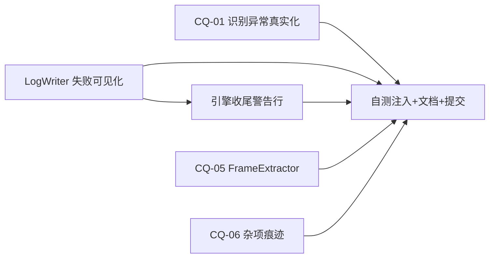

# DwgToPdf B2 异常可见化批 增量设计文档

> 版本 v1.0 · 2026-10-16 15:5x · 主理人齐活林执笔
> 背景说明：本设计原派发架构师 Bob，其因平台连续故障（500/空流/网络超时）三次未能落盘；
> 其勘察结论（16 站点行号核对、SelfTest 白名单、注入可行性、E2E 基线）已保留，主理人
> 全部亲自复核后执笔。所有站点行号为 **B1 提交 28ac697 之后的当前行号**（PRD 中的行号为
> B1 前旧值，已平移，以此文附录 A 为准）。
> 上游：《.planning/prd-code-quality.md》（B2 = CQ-01 + CQ-02 + CQ-05 + CQ-06，中风险，⚠改行为）
> 样板：《.planning/design-b1.md》（B1 已收官：02f9233 + 28ac697，QA 独立验证 PASS）

---

## Part A：系统设计

### 1. Implementation Approach

#### 1.1 B2 的四个难点与对策

| # | 难点 | 对策 |
|---|---|---|
| ① | **改行为但成功路径必须零变化**（审查标准「成功路径零变化」红线） | 所有改动均为「异常/失败分支上补痕迹」；成功分支不新增任何分支、不改任何输出文案；V2 token 等价校验只覆盖不变部分，行为变化以定向断言佐证 |
| ② | **「抛异常 → 日志含异常」不可直接单测**（Q5 要求注入型断言） | 分两层：可纯化的逻辑抽成 internal 纯助手（单测直断言）；不可纯化的接缝用反射/坏图纸注入（见附录 B）。**不为测试改产品语义** |
| ③ | **FrameExtractor 无 logger 注入点**（PRD 原写「诊断日志 DWGTOPDF_LOG_DIR」行不通） | 改用既有线程安全后台设施 BgLogger（内部锁 + 自有文件），零签名改动；偏离理由见 §5-D1 |
| ④ | **「UI 可见提示」不想动 MainForm**（改界面会触发整套 UI 取证，半径失衡） | LogWriter 已有 onLine 镜像到界面日志面板的通道（ConverterEngine 构造处）：收尾警告行走同一条通道 → UI 自然可见，控件树零变化 → 按审查标准不触发 dump_controls，只做目视 + 截图；偏离说明见 §5-D2 |

#### 1.2 策略总览

```
原则：异常路径「要么取消语义不变、要么真实原因送达」；成功路径逐字节不变。
CQ-01  recogTask.Result catch 一分为二：OperationCanceledException 保持取消语义（置空字典+记一行）；
       其余异常记全异常（类型/消息/堆栈/阶段）后仍置空字典（chunk 失败范围不变，Q1 已裁决），
       并把真实原因透传到该 chunk 每张失败图纸的 Reason 尾部（替换误导性「图框问题」表述）。
CQ-02  LogWriter 增加 WriteFailed / WriteFailCount / LastWriteError；三处写盘 catch 置标志；
       首次失败 mirror 一条 BgLogger.Error；引擎收尾（「==== 转换结束 ====」行后）追加一行
       [警告] 日志写入失败：{原因} —— 该行走 onLine 镜像，UI 可见（Q2 已裁决）。
CQ-05  FrameExtractor 通用 catch（box=null 两处）记 BgLogger.Warn（含文件名+异常详情）；
       onFileDone 回调 catch（两处）记 BgLogger.Warn；box 的 null 语义不变。
CQ-06  六类静默点补痕迹：MainForm 粘贴/设置保存、RunHistory 读写、ConverterEngine 四处
       envelope catch、EnvironmentSelfCheck 修复失败、BgLogger 自身 chicken-egg 注释。
```

### 2. File List

| 文件 | 改动 | 性质 |
|---|---|---|
| 源码工程/LogWriter.cs | +WriteFailed/WriteFailCount/LastWriteError 三属性；三处写盘 catch 置标志 + 首次失败 BgLogger.Error 镜像；onLine catch 注释措辞校正 | 行为（失败路径） |
| 源码工程/ConverterEngine.cs | L126-127 catch 一分为二 + 全异常记录；+internal 纯助手 `RecognitionFailureNote`；ValidateChunkPipeline 增可选参数 `recogErrorNote`（默认 null）透传真实原因；收尾警告行（L1166 后）；四处 envelope catch 补注释 | 行为（失败路径）+ 注释 |
| 源码工程/FrameExtractor.cs | L426/L568 通用 catch → BgLogger.Warn；L427/L569 回调 catch → BgLogger.Warn | 行为（失败路径） |
| 源码工程/MainForm.cs | L1156-1158 粘贴 catch → BgLogger.Warn；L1936-1937 设置保存 catch → BgLogger.Warn | 行为（失败路径） |
| 源码工程/RunHistory.cs | L105 读失败、L112 写失败 → BgLogger.Warn；L135 Load catch 补注释 | 行为（失败路径）+ 注释 |
| 源码工程/EnvironmentSelfCheck.cs | L58-59 修复失败 catch 补注释 | 注释 |
| 源码工程/BgLogger.cs | L50-53 chicken-egg catch 补注释（说明为何不能再记自己 + 指向 CQ-02 机制） | 注释 |
| 自测试工程/Program.cs | +TestLogWriterFailureVisibility、+TestRecognitionFailureNote（附录 C，≥5 条新断言） | 测试 |
| 自测试工程/SelfTest.csproj | **无需改**（LogWriter/ConverterEngine/FrameExtractor/BgLogger/RunHistory/EnvironmentSelfCheck 均已在白名单） | — |
| 文档四件套 | 手册第 5 章 / 说明.txt「修订十」/ 运行说明.txt「修订十」/ 版本变更记录.txt | 文档 |

`grep` 佐证（SelfTest.csproj 白名单，15:5x 复核）：L29 FrameExtractor、L32/33 ConverterEngine、L39 LogWriter、L45 BgLogger、L57 RunHistory、L44 EnvironmentSelfCheck 均在列；MainForm.cs、SettingsForm.cs 不在列（CQ-06 的 MainForm 改动以编译 + 审查 + 手工复现佐证，不进单测）。

### 3. Data Structures and Interfaces

```csharp
// —— LogWriter.cs 新增（T1）——
public bool WriteFailed { get; private set; }        // 任一次写盘/收尾失败即为 true
public int WriteFailCount { get; private set; }      // 失败次数（降噪：>1 时不重复 mirror）
public string LastWriteError { get; private set; }   // 最近一次失败：类型: 消息

// —— ConverterEngine.cs 新增（T2）——
/// 纯助手：把识别任务异常翻译成用户可见原因。取消 → 返回 null（调用方保持取消语义）；
/// 其余 → "后台识别异常：{ExceptionType}: {Message}"。可空安全、不触网、无副作用。
internal static string RecognitionFailureNote(Exception ex);

// ValidateChunkPipeline 签名增补（T2，默认 null = 行为与现状逐字节一致）：
//   private Dictionary<string, FrameBox> ValidateChunkPipeline(
//       List<string> chunk, Dictionary<string, FrameBox> boxes, List<ConvertFile> files,
//       int total, string outputFolder, IProgress<ProgressUpdate> progress, LogWriter log,
//       string recogErrorNote = null)
// 行为：文件不在 boxes（识别未产出）时，Reason/Note/hint 追加 "；" + recogErrorNote（非空时）。
// 注意：chunk 失败文件范围不变（仍以 passed 为准），仅失败原因文案替换误导表述（Q1 口径）。

// —— 调用点（T2）——L126-127：
//   try { boxes = recogTask.Result; }
//   catch (OperationCanceledException)
//   {
//       // 取消语义保持：识别被用户停止，置空字典让本 chunk 走取消路径
//       log.WriteLine("[信息] 后台识别已取消（用户停止）。");
//       boxes = new Dictionary<string, FrameBox>(StringComparer.OrdinalIgnoreCase);
//   }
//   catch (Exception ex)
//   {
//       // CQ-02 口径：识别失败用户必须知道——记全异常并透传真实原因（Q1：chunk 范围不变）
//       log.WriteLine("[失败] 后台识别异常：" + ex.GetType().Name + ": " + ex.Message
//           + "\n" + ex.StackTrace);
//       boxes = new Dictionary<string, FrameBox>(StringComparer.OrdinalIgnoreCase);
//       recogErrorNote = RecognitionFailureNote(ex);   // 传给 ValidateChunkPipeline
//   }
```

### 4. Program Call Flow

三条异常路径（成功路径完全不走这些分支，无变化）：

```
路径① CQ-01 识别异常：
  recogTask.Result 抛非取消异常 → catch (Exception ex) → log.WriteLine 全异常
  → recogErrorNote = RecognitionFailureNote(ex) → ValidateChunkPipeline(..., recogErrorNote)
  → 未识别文件的 Reason 尾部追加真实原因（替换误导「图框问题」表述）→ 日志/UI 可见

路径② CQ-02 日志写盘失败：
  _w.WriteLine/Flush/Close 抛异常 → catch：WriteFailCount++、LastWriteError=类型:消息、WriteFailed=true
  → WriteFailCount==1 时 mirror：BgLogger.Error("运行日志写盘失败：" + LastWriteError + "（路径 " + _path + "）")
  → 引擎收尾 L1166 后：if (log.WriteFailed) log.WriteLine("[警告] 日志写入失败：" + log.LastWriteError + "，排查请以后台日志为准")
  └→ 该行走 onLine 镜像 → 界面日志面板可见（Q2 的 UI 提示）

路径③ CQ-05/CQ-06 杂项静默点：
  FrameExtractor 提取异常 → BgLogger.Warn("帧提取失败：" + 文件名 + "：" + 异常类型+消息)
  onFileDone 回调异常 → BgLogger.Warn("文件完成回调异常：" + ...)
  MainForm 粘贴/设置保存异常、RunHistory 读写异常 → BgLogger.Warn(...)
```

### 5. Anything UNCLEAR / 偏离设计（需 Engineer/QA 知悉，不阻塞）

- **D1**：CQ-05 诊断送达方为 **BgLogger 后台日志**（`发布程序 v4.17/运行日志/DwgToPdf_后台日志_YYYYMMDD.txt`），
  非 PRD 字面所述「DWGTOPDF_LOG_DIR」。原因：FrameExtractor 的 ExtractPool 私有方法链无 logger 参数，
  加参数要动 4 层签名；BgLogger 是既有线程安全后台设施（内部锁）。PRD 验收语义「诊断日志可检索具体
  异常消息」以满足，验收时按 BgLogger 文件检索。
- **D2**：Q2 的「UI 可见提示」经既有 LogWriter.onLine 镜像实现，**不改 MainForm 控件树** →
  按《代码审查标准与流程》§3.2 不触发控件树 dump 复测，UI 取证降格为：构造写盘失败场景跑一次转换，
  capture_win.py 截运行日志面板一张（可见警告行）。
- **D3**：CQ-01 真实原因透传采用「新增可选参数」而非改返回结构——保持 passed 集合与失败文件范围不变
  （Q1 裁决），最小化半径。
- **D4**：BgLogger.Warn 的文案前缀统一为中文短标签（「帧提取失败：」「文件完成回调异常：」…），便于检索。

---

## Part B：任务分解

### 6. Required Packages

无新增（全部使用 System/System.IO/System.Threading.Tasks 既有能力）。

### 7. Task List（按依赖排序，共 6 个任务）

#### T1 LogWriter 失败可见化（CQ-02 基础设施，P0）
- 文件：`源码工程/LogWriter.cs`（当前 L45 WriteLine / L70 Dispose）
- 做法：按 §3 增三属性；L57 catch（_w.WriteLine 失败）、L79 catch（Flush）、L86 catch（Close）
  内统一 `WriteFailCount++; LastWriteError = ex.GetType().Name + ": " + ex.Message; WriteFailed = true;
  if (WriteFailCount == 1) BgLogger.Error("运行日志写盘失败：" + LastWriteError + "（路径 " + _path + "）");`
  （_path 为 null（仅内存模式）时不可能进入这些 catch，无需判空镜像——但镜像文案对 null 安全）；
  L65 onLine catch 注释措辞校正为「best-effort：界面镜像失败不影响日志写出」。
- 验证：编译 0/0；附录 C 的 TestLogWriterFailureVisibility 全 PASS；成功路径 WriteFailed==false。

#### T2 ConverterEngine 识别异常真实化（CQ-01，P0）
- 文件：`源码工程/ConverterEngine.cs`
- 做法：按 §3 代码块改 L126-127；新增 internal 纯助手 `RecognitionFailureNote`（放文件末尾私有区，
  XML doc 注明纯函数）；ValidateChunkPipeline 增 `string recogErrorNote = null` 末参，仅在
  「文件不在 passed/boxes」的失败登记处追加「；」+ recogErrorNote（非空时）；两处调用点
  （L126 分支与串行路径首次 chunk 调用 L122）核对传参。
- 验证：编译 0/0；TestRecognitionFailureNote 全 PASS；E2E 回归失败原因文案人工抽查。

#### T3 引擎收尾警告行（CQ-02 收口，P0）
- 文件：`源码工程/ConverterEngine.cs`（收尾区，「==== 转换结束 ====」行后，当前 L1166 附近）
- 做法：`if (log.WriteFailed) log.WriteLine("[警告] 日志写入失败：" + log.LastWriteError + "；后续排查请以后台日志为准");`
- 验证：V6 构造场景（DWGTOPDF_LOG_DIR 指向不可写路径）跑一次转换，运行日志面板出现该行（截图佐证）。

#### T4 FrameExtractor 诊断与回调痕迹（CQ-05，P1）
- 文件：`源码工程/FrameExtractor.cs`
- 做法：L426 `catch { box = null; }` → `catch (Exception ex) { box = null; BgLogger.Warn("帧提取失败：" + f + "：" + ex.GetType().Name + ": " + ex.Message); }`；
  L568 同改；L427/L569 `try { onFileDone?.Invoke(f, box != null); } catch { }` →
  `catch (Exception ex) { BgLogger.Warn("文件完成回调异常：" + f + "：" + ex.GetType().Name + ": " + ex.Message); }`。
  box null 语义、OperationCanceledException/TimeoutException 两个特判分支不动。
- 验证：编译 0/0；V5 smoke 注入（附录 B-3）后 BgLogger 文件可检索「帧提取失败」。

#### T5 杂项静默点补痕迹（CQ-06，P1）
- 文件与改法：
  - `源码工程/MainForm.cs` L1156-1158 粘贴 catch → `catch (Exception ex) { BgLogger.Warn("剪贴板路径收集失败：" + ex.GetType().Name + ": " + ex.Message); }`；
    L1936-1937 设置保存 catch → `catch (Exception ex) { BgLogger.Warn("设置保存失败：" + ex.GetType().Name + ": " + ex.Message); }`；
  - `源码工程/RunHistory.cs` L105 读失败 → `catch (Exception ex) { BgLogger.Warn("运行历史读取失败：" + ex.GetType().Name + ": " + ex.Message); }`；
    L112 外层 catch → 同型「运行历史保存失败：」；L135 Load catch 补注释「best-effort：读不到历史按无历史处理」；
  - `源码工程/ConverterEngine.cs` 四处 envelope catch（当前 L404 重试清单收集、L437-438 失败分类摘要、
    L583-584 看门dog外层、L1163-1164 统计块）逐处补「为什么可以失败」注释（措辞见 §8）；
  - `源码工程/EnvironmentSelfCheck.cs` L58-59 → 注释「best-effort：/regserver 修复失败按未修复处理，转入结果上报」；
  - `源码工程/BgLogger.cs` L50-53 → 注释「chicken-egg：后台日志自身写盘失败无法再记入自身；运行日志侧另有 LogWriter 失败标志与镜像（v4.17 修订十 CQ-02）」。
- 验证：编译 0/0；V1 白名单核查；QA 手工复现两项（附录 B-4）。

#### T6 自测注入、文档四件套与提交（P0）
- 文件：`自测试工程/Program.cs`（新增两个测试方法，挂到 Main 的调用序列，附录 C 草案）；
  文档四件套（手册第 5 章增补「异常可见化三条路径」；说明/运行说明各增「修订十」节；
  版本变更记录增修订十行 + 事件段）。
- 提交：一个 commit（v4.17 修订十：代码质量 B2 异常可见化批……），**只提交不推送**。

### 8. Shared Knowledge

- 编译：`/c/Users/ZINOVIA/Desktop/ZZH/D盘/工具包合集/本地SDK/dotnet8/dotnet.exe build <csproj> -c Release`（0 警告 0 错误）
- SelfTest：`dotnet build 自测试工程/SelfTest.csproj -c Release --no-incremental` 后运行；控制台输出 GBK，管道抓取按 GBK 解码
- **教训①（B1 实测）**：任何清单/校验脚本按**内容特征**锚定站点，严禁按行号（B1 注释插入致行号平移曾造成 B1_TODO=15 假失败）
- **教训②**：主工程重建后 SelfTest 必须 `--no-incremental`（PRJ-002）；领域规则进 SelfTest.csproj 白名单（PRJ-003）
- 注释措辞参考（envelope catch）：L404「best-effort：重试清单收集失败按无重试处理」；L437「best-effort：失败分类摘要失败不影响主流程」；L583「best-effort：看门狗异常退出不影响转换主流程」；L1163「best-effort：统计块失败不影响收尾」
- 全量回归基线 **113/115**（2 张 H77 风扇件为既有失败，手册第 30 章，不得计入 B2 引入）

### 9. 验证方案（V1~V6）

| # | 项 | 判据 | 执行 |
|---|---|---|---|
| V1 | 变更面 | git diff --stat 与 §2 File List 逐项吻合；无白名单外文件 | Engineer 自验 + QA 独立 |
| V2 | CQ-01 注入断言 | TestRecognitionFailureNote ≥3 条全 PASS：取消→null；InvalidOperationException("boom")→含类型与消息；null 入参安全 | 乔 SelfTest 默认集 |
| V3 | CQ-02 注入断言 | TestLogWriterFailureVisibility 全 PASS：反射关 _w 后 WriteLine → WriteFailed=true 且 LastWriteError 含 "ObjectDisposedException"；正常构造 + 写多行 → WriteFailed=false | 同上 |
| V4 | 编译与回归 | 主工程 0 警告 0 错误；SelfTest `--no-incremental` 重建后 **108+N 全 PASS（exit 0）** | Engineer + QA 各跑一次 |
| V5 | CQ-05 smoke 注入 | 坏图纸（`_对比探针/dwglist_smoke.txt` 既有坏用例）跑提取 smoke → BgLogger 后台日志可检索「帧提取失败」+ 具体异常消息；box null 语义不变（既有断言不破） | QA（宿主机有 AutoCAD） |
| V6 | E2E 与痕迹检索 | `--dirs` 全量回归 113/115；构造不可写 logDir 场景一次转换：BgLogger 可检索「运行日志写盘失败」+ 收尾「[警告] 日志写入失败」；运行日志面板截图一张（D2） | QA |

### 10. Task Dependency Graph



---

### 附录 A：站点坐标复核表（主理人 2026-10-16 15:5x 亲核，当前 main=28ac697）

| CQ | PRD 旧行号 | 当前行号 | 内容 |
|---|---|---|---|
| CQ-01 | 126-127 | **126-127**（声明 111、StartNew 134、收尾 152-155） | recogTask.Result catch 置空字典 |
| CQ-02 | 55-59/76-80/83-87 | **57-59 / 79-81 / 86-88** | LogWriter 三处写盘 catch |
| CQ-05 | 425/562、426/563 | **426/427、568/569** | box=null 与 onFileDone 回调 |
| CQ-06 | 1152-1154 | **1156-1158** | MainForm 粘贴 catch |
| CQ-06 | 1928-1930 | **1936-1937** | MainForm 设置保存 catch |
| CQ-06 | 104/111 | **105/112** | RunHistory 读/写 catch |
| CQ-06 | 404/437/580/1157/1188 | **404 / 437-438 / 583-584 / 1163-1164** | ConverterEngine envelope catch |
| CQ-06 | 58 | **58-59** | EnvironmentSelfCheck 修复失败 |
| CQ-06 | 50 | **50-53** | BgLogger chicken-egg |

### 附录 B：注入手段细则

- **B-1（V3）反射关流**：SelfTest 内 `var w = (StreamWriter)typeof(LogWriter).GetField("_w", BindingFlags.NonPublic|BindingFlags.Instance).GetValue(lw); w.Close();` 后 `lw.WriteLine("x")` → ObjectDisposedException 被 catch → 断言标志/错误串。测试后对象丢弃，无残留。
- **B-2（V2）纯助手**：`RecognitionFailureNote` 不依赖任何外部状态，直接断言返回值。
- **B-3（V5）坏图纸 smoke**：复用 `RunExtractSmoke` 既有路径与 `_对比探针/dwglist_smoke.txt`（内含失败用例）；跑完读 BgLogger 文件（路径 = SelfTest exe 同级 `运行日志\DwgToPdf_后台日志_<今天>.txt`）grep「帧提取失败」。
- **B-4（QA 手工复现）**：① 设置保存失败：把 `%APPDATA%\DwgToPdf\settings.json` 设为只读 → 改设置保存 → BgLogger 可检索「设置保存失败」；② 粘贴失败不可稳定构造（剪贴板竞争），以代码审查代替，注明原因。

### 附录 C：新增 SelfTest 断言草案（≥5 条，默认集 108+N）

```
TestLogWriterFailureVisibility（V3，白名单内 LogWriter.cs）：
  N1 正常构造+写 3 行 → WriteFailed==false（成功路径零变化实证）
  N2 反射关 _w 后写 1 行 → WriteFailed==true 且 LastWriteError 含 "ObjectDisposedException"
  N3 连续再次写 1 行 → WriteFailCount==2（不重复 mirror，仅计数）
TestRecognitionFailureNote（V2，白名单内 ConverterEngine.cs）：
  N4 RecognitionFailureNote(new OperationCanceledException()) == null（取消语义保持）
  N5 RecognitionFailureNote(new InvalidOperationException("boom")) 含 "InvalidOperationException" 与 "boom"
  N6 RecognitionFailureNote(null) 不抛异常（可空安全）
```

> 验收口径总则（对齐 PRD B2 行 + 审查标准 §4.4）：V1~V6 全过 + 文档四件套同步 + 用户弹窗验收 + P2/P3 台账清零/入账。


---

## 补记（2026-10-16 实施后复审归档 · architect-2 复审 + 主理人核定）

1. **missing 图纸真实原因的透传降级（原 P2-1，已释）**：§3 曾述「Reason/Note/hint 追加 recogErrorNote」，
   实施落定为**仅块级失败汇总日志行**（ConverterEngine.cs:321-323）。理由：pipeline 模式下 missing 文件
   本就不 AddRecord / 不上报进度（既有行为），硬做逐文件 Reason 需先引入失败登记，会扩大失败范围并改变
   UI 失败计数，风险大于价值；块级行已含真实原因，用户可按文件名对号入座。技术债挂账 **B3 评估**
   （成本中等 / 价值中等：缺的只是「双击失败项即见原因」的 UI 直达）。**验收与后续设计以本条为准，§3 旧表述作废。**
2. **D2 承诺边界（仅内存模式）**：主程序默认仅内存模式（path=null）时 _w 为 null，WriteFailed 恒 false，
   收尾 [警告] 日志写入失败行永不出现——构造正确（无文件可写失败）；Q2 的「UI 可见提示」仅在落盘模式
   （显式设置 DWGTOPDF_LOG_DIR）时兑现。QA 构造写盘失败场景必须置该环境变量（默认内存模式构造不出，勿误报）。
3. **P3 待办去向**：① LogWriter.cs WriteLine catch 缩进比 Dispose 两处少一级（风格，顺手修）；
   ② ConverterEngine.cs:724 / 677（COM 回退 / 整批超限收尾路径）缺收尾警告行（边缘路径 UI 可见性）——
   均并入 B3 或下一顺手批，不阻塞 B2 验收。
